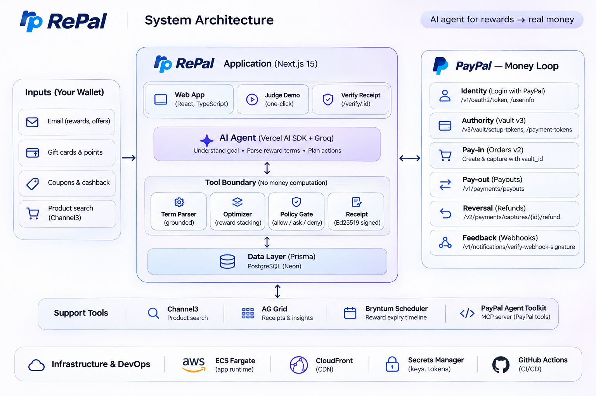
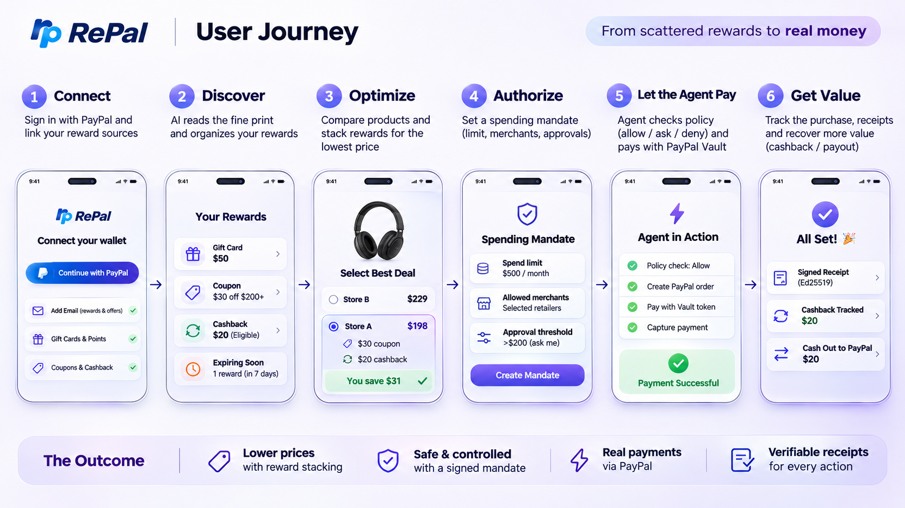

<div align="center">



# 💸 RePal — *Rewards to Real Money, on PayPal*

### **The cheapest price *after* your rewards.**

Your rewards are scattered across a dozen apps — coupons, gift cards, cashback, points — and half of them expire before you ever use them.
**RePal** is an agentic rewards‑to‑money layer: state a goal in plain language, the AI reads every reward's fine print, a **deterministic** optimizer **stacks the eligible ones** into the cheapest price, and **PayPal moves the money** end‑to‑end.

[](https://d14t147d5f4q6i.cloudfront.net)
&nbsp;
[](https://devpost.com)


</div>

> 🧭 **Litmus test — why PayPal is the core, not a checkout button:** remove PayPal and the agent *cannot act, get paid, or pay you back.* The mandate **is** a PayPal **Vault** token; cashback settles via PayPal **Payouts**; every move is a signed, verifiable receipt.
>
> 🔒 **Prime directive:** the **LLM never computes money.** The optimizer and policy engine are **deterministic, temperature‑0, and unit‑tested** — the model only *reads, plans, explains, and asks.* Every PayPal call passes a signed policy gate first.

---

## 🧮 The headline trick: **coupon stacking that respects the fine print**

RePal checks **every** reward you hold against **one** purchase, reads each one's terms (store, category, minimum spend, expiry, "cannot be combined"), and stacks only the ones that actually fit — coupons first, then gift cards & certificates as tender, then cash back. What's left is a **single PayPal payment.**

> 🎧 **Sony WH‑1000XM5 @ Best Buy — list `$249.99`**

| ✅ / ❌ | Reward | Applied | Why |
|:---:|---|---:|---|
| ✅ | Best Buy **10% off audio** (cap $40) | **−$25.00** | right store · right category |
| ✅ | My Best Buy **$40 certificate** (exp. 6d) | **−$40.00** | valid tender · used first (expiring) |
| ✅ | Best Buy **gift card** | **−$15.00** | no restrictions |
| ✅ | **Card rewards** via PayPal | **−$12.40** | no minimum at checkout |
| ❌ | Target $20 off $100+ | — | ✗ wrong store |
| ❌ | Amex $30 back | — | ✗ minimum spend $300 not met |
| ❌ | Best Buy 15% off **appliances** | — | ✗ wrong category |
| ❌ | Best Buy $5 off | — | ✗ expired |
| ❌ | Starbucks gift card | — | ✗ wrong store |

```
  $249.99  ──► stack 4 of 9 eligible rewards ──►  $157.59   🟢 you save $92.40
           coupons → gift cards/certificates → cashback, in one PayPal capture
```

**4 of 9 fit. 5 don't — and RePal tells you exactly why.** The money math is deterministic (`lib/stack/compute.ts`, unit‑tested); the LLM only parses the terms. See it at **[`/stack`](https://d14t147d5f4q6i.cloudfront.net/stack).**

---

## 🗺️ User journey — from scattered rewards to real money



| | Step | What happens |
|:---:|---|---|
| 1️⃣ | **Connect** | Sign in with PayPal, link your reward sources (Gmail, cards, loyalty, PayPal) |
| 2️⃣ | **Discover** | An AI agent reads the fine print and organizes your wallet — with a confidence score |
| 3️⃣ | **Optimize** | Compare products and **stack rewards** for the lowest price *after* rewards |
| 4️⃣ | **Authorize** | Set a spending **mandate** — limit, merchants, approval threshold (PayPal Vault) |
| 5️⃣ | **Let the agent pay** | Policy check `allow / ask / deny` → pay with the Vault token → capture |
| 6️⃣ | **Get value** | Signed receipt, cashback tracked, and **cash out** stuck rewards to real PayPal balance |

---

## ✨ Features

| | Feature | |
|:---:|---|---|
| 🎁 | **Reward Wallet** | Auto‑imported from Gmail, cards, loyalty & PayPal — each reward **AI‑parsed** with a confidence score. |
| 🤖 | **RePal Agent** | Natural‑language goals → plan. **Vercel AI SDK** with a **provider fallback chain** (Bedrock → Groq → Gemini → OpenRouter) that degrades gracefully. |
| 🧮 | **Coupon stacking** | Deterministic, T&C‑aware stacking into one PayPal payment. *The LLM never touches the math.* |
| 🛡️ | **Mandate Studio** | A 3‑step wizard (Limits → Permissions → Review) that mints a **revocable PayPal Vault** spending token with cap, budget & approval threshold. |
| 💸 | **Reward → cash** | Liberate a stuck reward to real balance via **PayPal Payouts**, bounded to its value, with a signed receipt. |
| 🧾 | **Verifiable receipts** | Every action is **Ed25519‑signed** and re‑checkable at `/verify/:id`. |
| 📊 | **Insights** | Spend, savings‑after‑rewards, cashback liberated — a searchable **AG Grid** of your signed receipts. |
| ⏰ | **Reward Rescue** | A **Bryntum** timeline plotting every reward against its expiry (🔴 ≤7d · 🟠 ≤30d) so value never vanishes. |

---

## 🏗️ System architecture


**Three planes, one money loop:**

- 📥 **Inputs (your wallet)** — email rewards, gift cards & points, coupons & cashback, Channel3 product search.
- 🧠 **RePal app (Next.js 15)** — Web App · one‑click Judge Demo · **AI Agent** (understand → parse terms → plan) above a **Tool Boundary** (*no money computation*): **Term Parser** (grounded) · **Optimizer** (reward stacking) · **Policy Gate** (`allow / ask / deny`) · **Receipt** (Ed25519). Backed by **Prisma + Neon Postgres**.
- 💙 **PayPal — the money loop** — Identity (Login) · Authority (**Vault v3**) · Pay‑in (**Orders v2**) · Pay‑out (**Payouts**) · Reversal (**Refunds**) · Feedback (**Webhooks**).
- 🧰 **Support tools** — Channel3 (product search) · AG Grid (receipts & insights) · Bryntum (expiry timeline) · PayPal Agent Toolkit (MCP server).
- ☁️ **Infra & DevOps** — AWS **ECS Fargate** · **CloudFront** CDN · **Secrets Manager** · keyless **GitHub Actions** OIDC CI/CD.

---

## 💙 The PayPal money loop

| Stage | PayPal API | In RePal |
|---|---|---|
| 🔑 **Identity** | `oauth2/token`, `userinfo` | Log in with PayPal (OIDC) |
| 🛡️ **Authority** | Vault v3 `setup-tokens` → `payment-tokens` | The spending **mandate** token |
| 🛒 **Pay‑in** | Orders v2 (create + capture with `vault_id`) | Agent pays within policy |
| 🔁 **Pay‑out** | Payouts | **Reward → real cash** |
| ↩️ **Reversal** | Refunds | Reversible, persisted |
| 📡 **Feedback** | Webhooks (signature‑verified) | Idempotent event handling |

---

## 🚀 Quick start

```bash
cp .env.example .env.local        # 🔑 fill sandbox keys (PayPal, DB, AI providers)
npm install
npm run prisma:generate
npm run dev                       # 🌐 http://localhost:3000
npm test                          # ✅ deterministic core (optimizer, policy, receipts)
```

- `DATABASE_URL` → Postgres (a Neon pooled URL works). Seed a demo wallet: `npm run seed`.
- 🧑‍⚖️ No PayPal/Gmail of your own? Click **Judge demo** on the live site for a one‑click, self‑contained account.
- 🤖 **AI providers:** set any of `GROQ_API_KEY`, `GEMINI_API_KEY`, `OPENROUTER_API_KEY`, or AWS Bedrock creds — the chain uses whatever's configured and fails over automatically.

---

## 🤝 Sponsor integrations

| Sponsor | Where | What |
|---|---|---|
| **PayPal Agent Toolkit** | `scripts/paypal-mcp.ts` · [`docs/MCP.md`](docs/MCP.md) | An **MCP server** (`@paypal/agent-toolkit/mcp`) exposing PayPal rails to any MCP client — `npm run paypal:mcp`. |
| **Channel3** | Shop | Live product discovery feeding the optimizer. |
| **AG Grid** | `/insights` | Sortable/filterable/searchable receipt grid (v36 Theming API, theme‑aware). |
| **Bryntum** | `/rescue` | A **Scheduler** timeline plotting rewards against expiry. |

---

## 🧭 Repo map

| Path | What |
|---|---|
| `app/` | Next.js 15 App Router — UI + API routes |
| `components/` | UI: `wallet/` (dashboard), `mandate/` (Mandate Studio), `rescue/` (Bryntum), `insights/` (AG Grid), `shop/` (reward stack) |
| `lib/` | **Deterministic core** — `stack/` (coupon stacking), policy, receipts, T&C parsing, PayPal adapters, AI fallback chain |
| `scripts/` | `paypal-mcp.ts` (MCP server), smoke tests, seeds |
| `prisma/` | Schema, migrations, seed · `workers/` reward ingestion + expiry scan |
| `docs/` | [`TECH_PRD.md`](docs/TECH_PRD.md) · [`DEPLOY_AWS.md`](docs/DEPLOY_AWS.md) · [`MCP.md`](docs/MCP.md) · [`PAYPAL_SETUP.md`](docs/PAYPAL_SETUP.md) |

---

<div align="center">

### 🟣 Make every reward count. — *Your rewards, turned into real money.*

**Built with 💙 for the PayPal AI Hackathon** · [MIT License](LICENSE)

</div>
