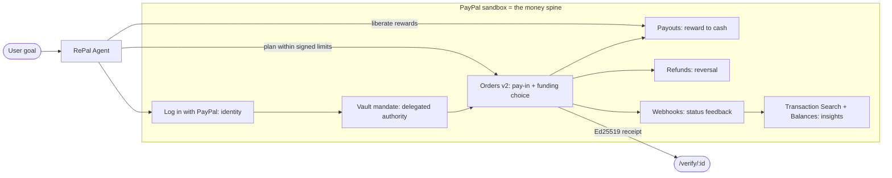

# RePal × PayPal Sandbox — Developer Documentation

_The agentic rewards-to-money layer, with the PayPal sandbox at the center of the idea._

_Last updated: 2026-11-14 · PayPal AI Hackathon 2026 · Sandbox (`PAYPAL_ENVIRONMENT=SANDBOX`)_

---

## 0. TL;DR

RePal is an **agentic-commerce** app: you state a goal in plain language, an AI agent reads
your rewards' fine print, a **deterministic** optimizer finds the cheapest SKU *after* your
rewards, and **PayPal moves the money across the entire lifecycle** — identity, delegated
authority, pay-in, pay-out, reversal, reporting. The LLM **never computes money**; every
number comes from a deterministic `lib/` pipeline, and every spend is re-checked against a
cryptographically-signed, revocable mandate before a cent moves.

> **Litmus test:** remove PayPal and the agent cannot authenticate the user, act within
> delegated authority, pay, get the user paid back, or report. PayPal is the spine, not a
> checkout button.

RePal currently uses **~9 distinct PayPal products as one coherent money loop** — far beyond
the single-API (Orders/Checkout) integration most hackathon entries ship.

---

## 1. The idea — PayPal at the center

Every stage maps to a real PayPal REST call (§3) and a verifiable, signed artifact (§4).

---

## 2. Sandbox setup

### 2.1 App + credentials
- Sandbox REST app ("Default Application") with **Vault enabled** and the **Transaction
  Search** / **Reporting** features enabled (both verified live — see §3.7).
- Secrets live in `.env` locally and AWS Secrets Manager (`repal/PAYPAL_*`) in prod. **Never**
  commit values; `.env` is gitignored.

### 2.2 Environment variables (names only)
| Var | Purpose |
|---|---|
| `PAYPAL_ENVIRONMENT` | `SANDBOX` (default) or `LIVE` → selects the base host (`lib/paypal/client.ts:12`). |
| `PAYPAL_CLIENT_ID` / `PAYPAL_CLIENT_SECRET` | OAuth client-credentials (Basic auth). |
| `PAYPAL_OIDC_REDIRECT` | OIDC callback URL; also the source of the public origin for post-login redirects. |
| `PAYPAL_WEBHOOK_ID` | Required for webhook signature verification; unset ⇒ events stored but not verified/applied. |

Base host (`lib/paypal/client.ts:14`): `https://api-m.sandbox.paypal.com` (sandbox) ·
`https://api-m.paypal.com` (live). OIDC authorize host: `https://www.sandbox.paypal.com/connect`.

### 2.3 Sandbox accounts
- **Business** account backs the API credentials (the merchant). **⚠️ It is India-region (IN).**
- **Personal** (buyer) accounts (`sb-…@personal.example.com`, pre-funded) are used to log in and
  to receive Payouts.

### 2.4 Known sandbox gotchas (all handled in code — see §5)
| Gotcha | Effect | RePal's handling |
|---|---|---|
| **IN business account can't send Payouts** | `403 PAYOUT_NOT_AVAILABLE` | Degrades to an honest **simulated payout** (real signed receipt, no money moved). |
| **Vault approval is fragile in sandbox** | setup-token round-trip can half-complete | Vault is **opt-in** (`?vault=1`); default is an instant signed policy-only mandate; Vault failure degrades to it. |
| **"Log in with PayPal" has no Google option** | friction | A one-click **judge/demo login** persona exists. |
| **OIDC consent needs Privacy + User-Agreement URLs** | consent won't save | Google policy URLs registered (a `cloudfront.net` root was rejected). |
| **Reporting data lags ~3h** | new txns not instantly visible | UI states this explicitly. |

---

## 3. The money lifecycle — API reference

Every adapter goes through `paypalRequest()` in `lib/paypal/client.ts` (Bearer token +
`PayPal-Request-Id` idempotency key on mutating calls). Token is cached in-memory with a 60s
safety margin (`getAccessToken()`).

### 3.1 Identity — Log in with PayPal (OIDC)
| | |
|---|---|
| Login | `app/api/auth/paypal/login/route.ts` → 302 to `…/connect?scope=openid profile email&response_type=code` |
| Callback | `app/api/auth/paypal/callback/route.ts` → `POST /v1/oauth2/token` (authorization_code) → `GET /v1/identity/openidconnect/userinfo?schema=openid` |
| Session | `lib/auth/session.ts` — signed httpOnly cookie `repal_session` (HMAC-SHA256 over base64url JSON, 7-day TTL, constant-time compare, **fails closed in prod** if `SESSION_SECRET` unset) |

Session accessors: `getSession()` (nullable) · `getSessionUser()` (falls back to `JUDGE_USER_ID`
for public read-only surfaces — **never for money**) · `requireUserId()` (strict, 401, used by
payout/refund). **⚠️ `state` is generated but not verified** — a documented demo CSRF trade-off (§7).

### 3.2 Authority — the Vault mandate (`lib/paypal/vault.ts`, `app/api/mandates/*`)
The mandate **is** the agent's delegated spending authority: cap, rolling budget, allow-list,
approval threshold. Two paths:

- **Instant signed (default):** create the `Mandate` row → `signMandate()` (Ed25519) → `active`.
  A real, enforceable policy mandate with **no Vault token, no redirect**.
- **Vault-backed (opt-in `?vault=1`):** `POST /v3/vault/setup-tokens` → buyer approves →
  `app/api/mandates/vault/callback` runs `POST /v3/vault/payment-tokens` → stores
  `paypalVaultTokenId`, **re-signs** to bind the token, flips to `active`. Any failure degrades
  to the instant signed mandate.

Only a **Vault-backed** mandate enables no-redirect agent auto-pay (`agentPay`, §4).

### 3.3 Pay-in — Orders v2 + agent-selected funding (`lib/paypal/orders.ts`)
- `createOrder()` → `POST /v2/checkout/orders` (`intent: CAPTURE`, USD). Modes:
  - **Agent-initiated:** `payment_source.paypal.vault_id` → no buyer redirect.
  - **Buyer-present:** `experience_context` (return/cancel, `PAY_NOW`, `NO_SHIPPING`).
- `captureOrder()` → `POST /v2/checkout/orders/{id}/capture`.
- **Agent-selected funding** (`lib/paypal/funding.ts`, pure + unit-tested): `selectFunding(amount)`
  deterministically picks the `payment_source` — **≥$100 → Pay Later**, **≤$30 → Venmo**, else
  **instant PayPal balance** — with a plain-language reason + one-tap override. `/api/pay/order`
  validates the `funding` enum and **falls back once to `paypal`** if a method fails (Venmo is
  US-only in sandbox) → `fundingFellBack:true`.

Routes: `POST /api/pay/order` (create, 10/60s rate-limit, server-built return URLs) ·
`POST /api/pay/capture` (capture + **second policy gate** before issuing a signed receipt).

### 3.4 Pay-out — Payouts / reward liberation (`lib/paypal/payouts.ts`, `lib/payout/liberate.ts`)
The signature beat: cash unused/expiring reward value out to the user's PayPal balance.
- `createPayout()` → `POST /v1/payments/payouts` (single EMAIL recipient, USD).
- `liberateReward()` bounds the amount to the reward's value, persists a `Payout` row + a signed
  receipt, marks the reward `liberated` (no double-cash). **On the IN sender restriction it
  degrades to a simulated payout** (`SIMULATED-PAYOUT-*`, `status:"SIMULATED"`, genuine receipt,
  no money moved). Route: `POST /api/pay/payout` (`requireUserId` + rate-limit).

### 3.5 Reversal — Refunds (`lib/paypal/refunds.ts`)
- `refundCapture(captureId, amountUsd?)` → `POST /v2/payments/captures/{id}/refund` (full or
  partial). Route `POST /api/pay/refund` (`requireUserId`) persists a `Refund` row (status later
  updated by webhook) + a reversal receipt.

### 3.6 Feedback — Webhooks (`app/api/webhooks/paypal/route.ts`, `lib/paypal/webhooks.ts`)
- `verifyWebhookSignature()` → `POST /v1/notifications/verify-webhook-signature` (uses
  `PAYPAL_WEBHOOK_ID`). Every event is stored to `WebhookEvent` with a `verified` flag.
- `applyEffects()` runs **only on verified events**: `PAYMENT.PAYOUTS-ITEM*` → updates `Payout`
  status by batch id; `PAYMENT.CAPTURE.REFUNDED` / `PAYMENT.REFUND*` → updates `Refund` status.
  Always returns 200 (so PayPal doesn't retry a stored event).

### 3.7 Insights — Transaction Search + Balances (`lib/paypal/reporting.ts`)
- `searchTransactions()` → `GET /v1/reporting/transactions` (≤31-day window, `transaction_info`
  + `payer_info`). **Verified live** (returns a real settled txn).
- `getAccountBalance()` → `GET /v1/reporting/balances`. **Verified live** ($5000 available).
- Route `GET /api/paypal/transactions` returns both, **session-gated** (exposes account
  financials incl. sandbox payer emails), always 200 with honest `{available:false, reason}` states.
- **⚠️ Honesty constraint:** Reporting returns **RePal's own merchant account** activity, **not** a
  buyer's wallet — the UI labels it exactly that way. (A buyer's funding balance is never exposed
  by any PayPal API.)

---

## 4. Trust architecture

- **Ed25519-signed mandates & receipts** (`lib/policy/mandate.ts`, `lib/receipts/*`). The
  `signatureHash` is a **keyed signature, not a bare hash** — a tampered cap can't be re-hashed.
  The signed canonical form **binds `userId`**, so a signature can't be replayed onto another
  user's mandate. `verifyMandate()` returns false on tamper (never throws).
- **The LLM never computes money.** The orchestrator (`agents/orchestrator.ts`,
  `ToolLoopAgent`, `temperature:0`) only routes/reads/explains/asks. All prices, discounts,
  budgets, totals come from the deterministic `lib/pipeline` / DB.
- **Policy checked twice:** at plan time (`checkPolicy()` — pure, integer-cents rules:
  expired/cap/budget/category/merchant → deny, over-threshold → ask) and **again server-side**
  via `gateSpend()` inside `agentPay`, `/api/pay/capture`, and `/api/pay/demo-capture`. A
  tampered mandate → **hard deny**. The approval threshold **is** the human-in-the-loop boundary.
- **Every money action yields a verifiable receipt** at `/verify/:id`.

---

## 5. Real vs mock — the honesty contract

| Path | Real PayPal call? | Notes |
|---|---|---|
| OIDC login/callback | ✅ | token + userinfo exchange |
| `/api/pay/order` + `/capture` | ✅ | Orders v2 create + capture (incl. Venmo/Pay Later source) |
| `/api/pay/refund` | ✅ | Payments v2 refund |
| `/api/pay/payout` | ✅ / ⚠️ | real Payouts; **simulated** on IN sender restriction |
| `/api/mandates?vault=1` + callback | ✅ | real Vault setup/payment tokens |
| `/api/paypal/transactions` | ✅ | real Reporting (own account) |
| `/api/webhooks/paypal` | ✅ | real signature verification |
| **`/api/pay/demo-capture`** | ❌ **mock** | genuine Ed25519 receipt, `DEMO-*` ids, `{demo:true}`; used when `/api/pay/mode` reports `paypalConfigured:false`. Labeled "Sandbox — no live PayPal capture". |
| **Instant signed mandate** (default) | ❌ (not a PayPal object) | real signed policy; Vault is the opt-in PayPal-backed path |
| **`demoMandate()`** fallback | — | permissive $1000/$500 mandate so demos never hard-block |
| **Gmail ingestion** | — | dormant unless `GOOGLE_*` set; `scan_inbox` returns `connected:false`, falls back to labeled sample wallet |

**Rule:** a mock path is always labeled as such in the UI; a signed receipt is always genuine
even when no live capture happened.

---

## 6. Sandbox test playbook

| Flow | How to exercise |
|---|---|
| Identity | `/api/auth/paypal/login` with a sandbox **personal** account |
| Judge/demo | one-click judge login (persona "Maya"); no PayPal/Gmail needed |
| Mandate (signed) | `/mandate` → Authorize → instant active signed mandate |
| Mandate (Vault) | `/mandate?vault=1` → PayPal approval → payment token bound |
| Pay-in | `/shop` → product → checkout → funding choice → approve → capture → receipt |
| Pay-out | wallet reward → "Cash out to PayPal" (simulated in IN sandbox, labeled) |
| Refund | `POST /api/pay/refund` with a capture id |
| Webhooks | PayPal Developer → Webhooks simulator (or real events) |
| Insights | `/insights` → live Transaction Search + account balance |

---

## 7. Gaps, risks & what to change / optimize (prioritized)

**P0 — correctness / production-readiness**
1. **Authorization + Capture ("holds") instead of immediate `CAPTURE`.** Change Orders to
   `intent: "AUTHORIZE"` → `/v2/checkout/orders/{id}/authorize` → capture on fulfillment. This is
   the *correct* agentic pattern (reserve funds on intent, capture when the order is confirmed),
   and it unlocks **partial captures** and **voids/reauth**. _(A direct competitor already does
   this.)_
2. **Verify the OIDC `state`.** Persist + compare `state` (CSRF) before trusting the callback —
   currently generated but unchecked (`login/route.ts:14`).
3. **Idempotent money writes.** `PayPal-Request-Id` is set on PayPal calls; add a dedupe key on
   `Receipt`/`Payout` so a retried capture/payout can't double-issue a receipt.
4. **US sandbox business account** so Payouts + Vault complete *live* (removes the simulated path
   from the camera demo). Infra, not code.

**P1 — depth / polish**
5. **Partial captures + refunds end-to-end** in the UI (capture less than authorized; refund a
   portion) — a concrete, judge-visible "money lifecycle" beat.
6. **Shipment Tracking + Disputes** (both in the PayPal Agent Toolkit) to close the post-purchase
   loop — the agent adds tracking and can respond to a dispute.
7. **Session-gate `/api/pay/order` + `/capture`** (today they rely on the mandate gate with a
   `demo-user` fallback) — tighten for production while keeping a demo switch.

**P2 — optional**
8. **Subscriptions / Billing Plans** for a recurring-mandate variant. **Invoicing** for a B2B angle.

---

## 8. New agentic-commerce roadmap (the "what's next")

The strongest innovation lever is to adopt PayPal's **own** agentic-commerce stack and the
emerging **agent-payment protocols** — exactly the "what's next with PayPal + AI" the brief asks
for.

### 8.1 Wire the PayPal Agent Toolkit / MCP
- `@paypal/agent-toolkit` exposes PayPal (orders, invoices, disputes, shipment tracking, catalog,
  subscriptions, reporting) as **agent tools** for the Vercel AI SDK, and a **remote MCP server**
  at `https://mcp.sandbox.paypal.com` (reads a `PAYPAL_ACCESS_TOKEN`).
- RePal currently hand-rolls its REST calls. Swapping the money tools to the official toolkit (or
  exposing them via MCP) is a direct **sponsor-tool-use** win and future-proofs the integration.
- Keep the deterministic `gateSpend()` wrapper in front of every toolkit money tool so the
  "LLM-never-computes-money" invariant survives.

### 8.2 Speak AP2 (Agent Payments Protocol) — RePal is one adapter away
Google's **AP2** (PayPal is the most public partner) chains **three cryptographically signed
mandates**, expressed as **W3C Verifiable Credentials**:

| AP2 mandate | What it is | RePal already has |
|---|---|---|
| **Intent Mandate** | user pre-approves conditions (budget, categories, timing) for later agent action | the **Ed25519 signed spending mandate** (cap/budget/allow-list/threshold) |
| **Cart Mandate** | user approves a specific cart at a specific price | the **optimizer's signed plan** + confirm-to-pay |
| **Payment Mandate** | minimal credential appended to the auth request, signaling agent presence | the **signed receipt** / order metadata |

**Action:** add an adapter that serializes RePal's mandate → an AP2 Intent Mandate VC and the
plan → a Cart Mandate VC. This reframes RePal's existing cryptographic trust model as a
**standards-compliant agent-payments implementation** — a genuine "new payment experience."

### 8.3 ACP (OpenAI Agentic Commerce Protocol)
PayPal also adopted OpenAI's **ACP** (checkout inside ChatGPT). The minimum-viable protocol set
for 2026 is **ACP + AP2 + TAP**. A stretch goal is an ACP checkout surface so the agent can
transact from within an assistant.

---

## 9. How this wins (judging-criteria mapping)

PayPal AI Hackathon 2026 scores **five equal criteria**. Prize targets: **Best Use of Agentic
Commerce ($5k)** — whose official example *is* RePal — and **Best Use of PayPal + AI ($5k)**.

| Criterion | RePal's edge | Lever to pull |
|---|---|---|
| **Technical implementation** | ~9 PayPal products as one loop; signed mandates/receipts; policy gated twice | add **holds/partial-capture** + **Agent Toolkit** (§7–8) |
| **Innovation / "what's next"** | agentic **rewards→cash under a signed mandate** | ship the **AP2 mandate mapping** (§8.2) |
| **Potential impact** | real pain: stuck gift cards/points → real money | keep the Payouts liberation front-and-center |
| **Design** | polished UI, honest sandbox labeling, agent-selected funding | flawless mobile + the funding-choice moment |
| **Presentation** | verifiable receipts, live Insights (Txn Search + Balances) | a crisp **<3-min demo** of the signature beats *actually completing* |

**Biggest single lever:** a demo video showing the signature beats *actually working* end-to-end
— which the simulated-payout fallback + Gemini-first AI now make possible without external gates.
A **US sandbox business account** upgrades the payout beat from "simulated" to "real money moved"
on camera.

**Differentiation vs the nearest competitor** (another signed-mandate spend-gate entry): RePal
alone has **reward→cash liberation**, **agent-selected funding**, and **live Transaction Search +
Balances**. Lean into the rewards story — it's the moat.

---

## 10. Quick file map

| Concern | Files |
|---|---|
| Transport / OAuth | `lib/paypal/client.ts` |
| Orders + funding | `lib/paypal/orders.ts`, `lib/paypal/funding.ts`, `app/api/pay/order`, `app/api/pay/capture` |
| Vault / mandate | `lib/paypal/vault.ts`, `app/api/mandates/*`, `lib/policy/mandate.ts` |
| Payouts | `lib/paypal/payouts.ts`, `lib/payout/liberate.ts`, `app/api/pay/payout` |
| Refunds | `lib/paypal/refunds.ts`, `app/api/pay/refund` |
| Webhooks | `lib/paypal/webhooks.ts`, `app/api/webhooks/paypal` |
| Reporting | `lib/paypal/reporting.ts`, `app/api/paypal/transactions`, `components/insights/PayPalActivity.tsx` |
| Policy gate | `lib/policy/gate.ts`, `lib/policy/index.ts` |
| Agent | `agents/orchestrator.ts`, `lib/agent/actions.ts` |
| Auth / session | `app/api/auth/paypal/*`, `lib/auth/session.ts`, `lib/demo/judge.ts` |

---

## References
- PayPal Agent Toolkit — https://developer.paypal.com/community/blog/paypal-agentic-ai-toolkit/ · repo `github.com/paypal/agent-toolkit`
- PayPal MCP server — https://developer.paypal.com/community/blog/paypal-model-context-protocol/ (`mcp.sandbox.paypal.com`)
- PayPal × AP2 — https://developer.paypal.com/community/blog/PayPal-Agent-Payments-Protocol/
- AP2 explained — https://eco.com/support/en/articles/14845479-ap2-agent-payments-protocol-explained
- PayPal AI resources — https://developer.paypal.com/ai-tools/get-started
